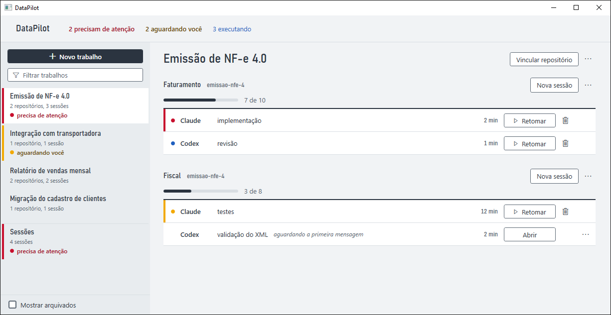
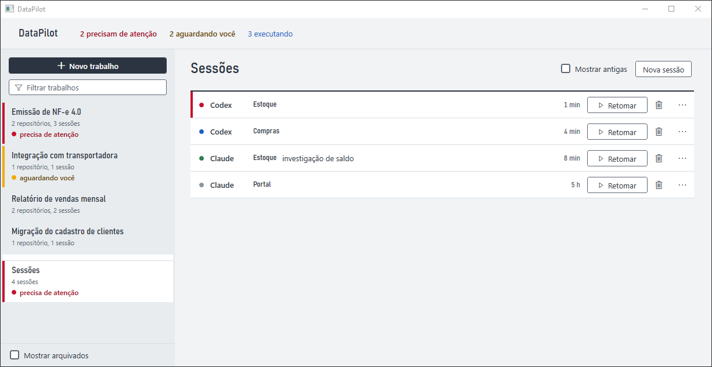
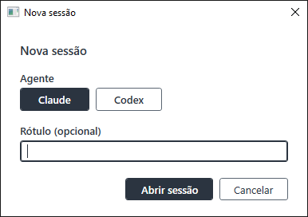
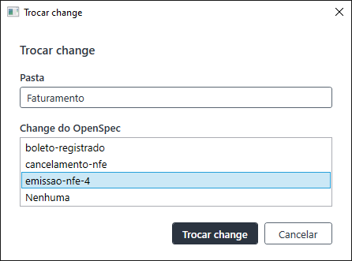
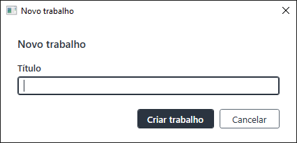
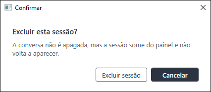

  

<h1 align="center">DataPilot</h1>

  <em>Várias sessões de IA trabalhando ao mesmo tempo. Um só painel para saber qual delas precisa de você.</em>

  
  
  
  
  

  

---

O DataPilot é um painel para Windows que organiza as sessões do **Claude Code** e do **Codex** pelo trabalho a que pertencem. Em vez de procurar entre dezenas de abas de terminal, você vê de relance o que está executando, o que terminou e o que está parado esperando uma resposta sua. Com um clique, você abre uma sessão nova ou volta à conversa certa.

## O que ele entrega

- **Trabalhos em vez de abas soltas.** Cada trabalho reúne os repositórios envolvidos e as sessões de IA de cada um.
- **Status sempre atualizado.** Uma cor por sessão mostra se ela precisa de atenção, aguarda você, está executando, está ativa ou já encerrou.
- **O que importa primeiro.** O topo da janela conta as sessões que dependem de você, e **F8** leva direto à próxima.
- **Abrir e retomar com um clique.** Cada sessão abre numa aba do Windows Terminal, já no repositório certo e com um título que diz de onde ela é.
- **Progresso do OpenSpec por repositório.** O card de cada repositório mostra a change em andamento e quantas tarefas já foram concluídas.
- **Sessões avulsas no mesmo lugar.** Conversas iniciadas fora de um trabalho também aparecem, prontas para retomar ou organizar.

## Tudo organizado por trabalho

Um trabalho é uma entrega: uma correção, uma funcionalidade, um relatório. Ele pode envolver mais de um repositório, e cada repositório tem as próprias sessões. A lista à esquerda fica ordenada pelo que é mais urgente, com uma faixa colorida nos trabalhos que precisam de você.

Criar um trabalho pede só um título. Para vincular um repositório, basta escolher a pasta no Windows.

| Cor | Significado |
|---|---|
| 🔴 Vermelho | A sessão precisa de atenção |
| 🟡 Amarelo | A sessão terminou e aguarda você |
| 🔵 Azul | O agente está executando |
| 🟢 Verde | A sessão está aberta e ociosa |
| ⚪ Cinza | A sessão está inativa ou encerrada |

## Sessões

Nem toda conversa nasce dentro de um trabalho. A área **Sessões** reúne as sessões avulsas, inclusive as abertas fora do painel, com o repositório de cada uma. Dela você retoma uma conversa, abre uma sessão nova em qualquer repositório ou vincula a sessão a um trabalho quando ela ganhar contexto.

  

## Abrir, retomar e organizar

Os diálogos são diretos: pedem só o que é necessário e mostram o erro junto do campo quando algo precisa de correção. Excluir uma sessão pede confirmação, e **Enter** não confirma a exclusão.

<table>
  <tr>
    <td align="center" width="50%">
       
      <b>Nova sessão:</b> escolha o agente e, se quiser, dê um rótulo.
    </td>
    <td align="center" width="50%">
       
      <b>Change do OpenSpec:</b> as changes do repositório aparecem numa lista.
    </td>
  </tr>
  <tr>
    <td align="center" width="50%">
       
      <b>Novo trabalho:</b> basta o título.
    </td>
    <td align="center" width="50%">
       
      <b>Excluir:</b> a sessão sai do painel e a conversa é mantida.
    </td>
  </tr>
</table>

## Feito para o dia a dia

- **Teclado em primeiro lugar.** **Ctrl+N** cria um trabalho, **Ctrl+F** filtra a lista e **F8** vai para a próxima sessão que precisa de você. As ações secundárias ficam num menu, aberto pelo botão direito ou por **Shift+F10**.
- **Calmo por padrão.** A janela usa cor só para sinalizar o que pede ação. O resto fica neutro.
- **Acessível.** Com o alto contraste do Windows ligado, o painel adota as cores do sistema e mostra o nome do status em texto.
- **Separação de papéis.** Os agentes de IA rodam isolados do usuário que usa o painel. O painel só lê o status das sessões e nunca executa nada que venha delas.

## Requisitos

- Windows 10 ou 11, com o Windows Terminal
- Claude Code, Codex ou os dois

A preparação do ambiente está em [docs/instalacao-etapa-1.md](docs/instalacao-etapa-1.md). A compilação, os dados de exemplo e os roteiros de verificação estão em [docs/desenvolvimento.md](docs/desenvolvimento.md).

## Licença

Distribuído sob a licença [MIT](LICENSE).
